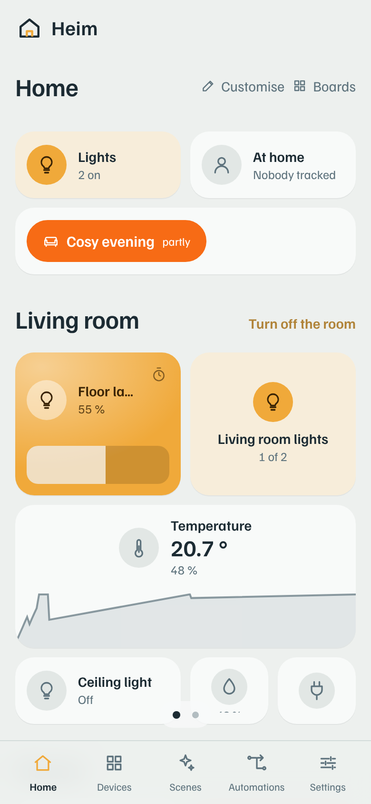
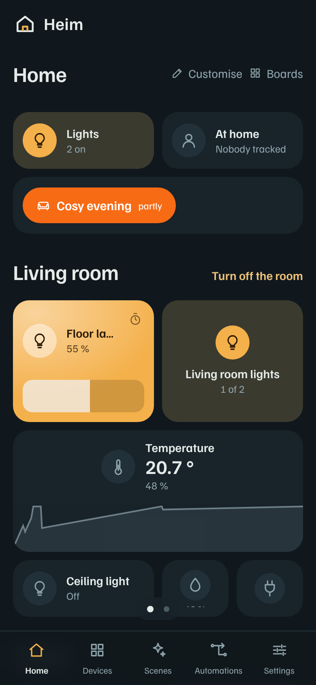
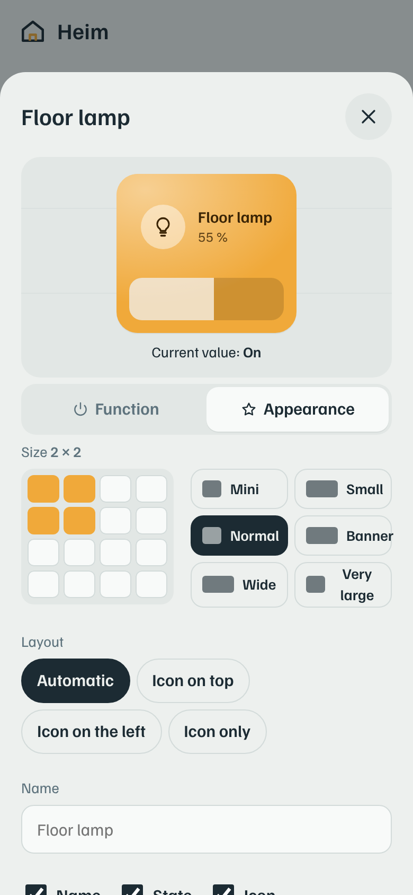
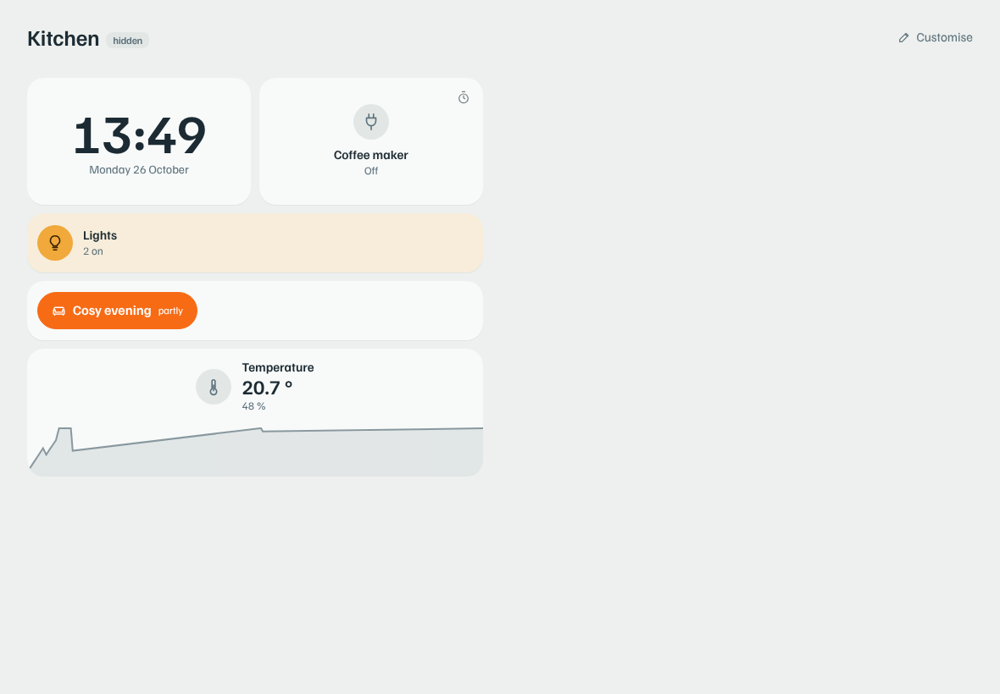
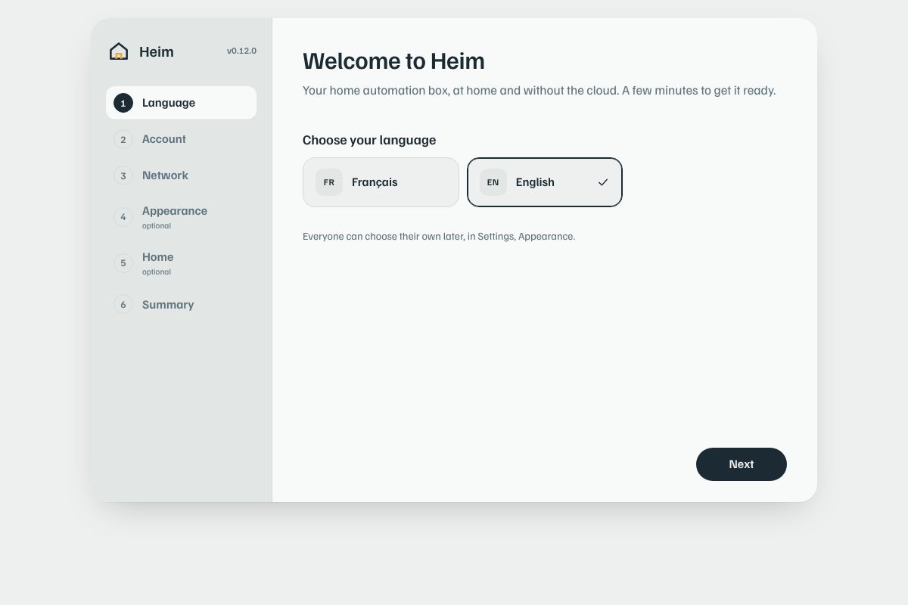

# Heim

**Une box domotique locale et économe.** Heim tourne sur un Raspberry Pi Zero 2 W ou un Pi 3 :
quelques watts et environ 10 Mo de mémoire. Ni cloud ni YAML : tout se règle depuis un téléphone.
Une clé Zigbee branchée sur la box, et c'est tout : Zigbee2MQTT et un broker MQTT sont fournis.

[English](README.md) · [API](docs/API.md) · [Sécurité](SECURITY.fr.md) · [Traduire](docs/TRANSLATING.md)

<p align="center">
  
  
  
</p>

## Pourquoi Heim

- **Local.** Vos appareils, vos règles, votre journal restent à la maison. Heim marche sans
  Internet ; rien ne passe par le serveur de quelqu'un d'autre.
- **Économe.** Un seul petit programme écrit en Rust. Environ 10 Mo de mémoire au repos, une base
  qui ménage la carte SD, et de la marge sur un Pi Zero 2 W (512 Mo).
- **Simple.** Aucun fichier de configuration : appareils, pièces, scènes et automatismes se
  règlent dans l'interface, par n'importe qui à la maison.
- **Solide.** Chaque connexion est isolée et relancée si elle plante, un chien de garde systemd
  relance Heim s'il se fige, et une mise à jour revient toute seule en arrière si la nouvelle
  version ne démarre pas.

## Ce qu'il fait

### Accueil
- **Plusieurs tableaux**, qu'on change en glissant (petits points en bas) ou par onglets.
- **Tuiles de 1×1 à 4×4** sur une grille qui s'adapte à l'écran : icône, nom, état, et selon la
  place un curseur de luminosité, une courbe des 24 h ou les autres mesures de l'appareil.
  Déplacées d'un appui long, redimensionnées à la poignée.
- **Chaque tuile a deux onglets.** *Fonction* : appui court, long et double. *Apparence* :
  taille, disposition, une couleur allumée et une éteinte (celle d'une scène, ou n'importe
  laquelle), remplissage, et couleurs selon la valeur (« au-dessus de 25 °C : orange, *Chaud* »).
- **Ajouter une tuile** va vite : une recherche, et des filtres ronds pour les lumières, les
  prises, les capteurs et le reste.
- **Tuiles Maison** qui se recalculent toutes seules :
  - toutes les lumières, toutes les prises, une pièce ;
  - *Je pars* : tout s'éteint, et l'alarme s'active si vous le voulez ;
  - qui est là, alarme, automatismes déclenchés ;
  - piles faibles, injoignables ;
  - soleil, horloge, scènes, minuteurs.

### Appareils et connexions
- **Zigbee** par Zigbee2MQTT (clé Sonoff ZBDongle-E ou autre), **sur la box elle-même** :
  l'image SD l'installe, Heim trouve la clé USB, écrit sa configuration et le démarre.
  Appairage depuis l'appli, en direct. Un Zigbee2MQTT existant (celui de Home Assistant) se
  reprend sans rien réappairer, et Heim sait toujours lire un Zigbee2MQTT installé ailleurs.
- **Broker MQTT intégré** : Zigbee2MQTT se branche directement sur Heim, sans Mosquitto. On peut
  l'ouvrir au réseau de la maison pour des appareils Tasmota, Shelly ou ESPHome, chacun avec
  son compte.
- **Tuya Wi-Fi** : prises, ampoules et interrupteurs (LSC, Lidl…), pilotés en local, sans cloud
  (protocoles 3.3, 3.4 et 3.5).
- **Matter** par un serveur Matter (celui de Home Assistant, ou python-matter-server).
- Tous les réglages qu'un appareil propose (couleur, blanc, effets, fondus, état après coupure,
  verrouillage enfant…), mises à jour du logiciel interne, pile et signal d'un coup d'œil.

### Scènes et automatismes
- **Scènes** : chaque appareil réglé comme vous voulez, aperçu en direct sur les vraies lampes,
  modèles, fondus, « activer pour 2 h ».
- **Automatismes** : *Quand* (un appareil change, un seuil, une heure, lever ou coucher du soleil
  calculé sur place) / *Si* / *Alors* (commander, allumer pour un temps, scène, notifier,
  attendre). Chacun porte un état vrai/faux : « courrier arrivé » reste levé jusqu'au réarmement.

### Maison et famille
- **Alarme** : modes Absent et Nuit, délais d'entrée et de sortie, vérification avant activation,
  capteurs 24 h/24 (fumée, fuite), sirènes Zigbee, lumières, photos des caméras, code facultatif.
- **Présence** par les téléphones sur le Wi-Fi, sans GPS ni application.
- **Comptes** : admin, membre, invité. Pour chaque personne, on règle :
  - un tableau imposé ou libre ;
  - le droit de modifier ou d'ajouter des tuiles ;
  - les onglets visibles ;
  - les appareils en lecture seule.

  Ces droits sont vérifiés par le Pi lui-même.
- **Écrans et tablettes murales** : chaque téléphone ou tablette qui ouvre Heim apparaît dans
  Réglages, Écrans. Depuis votre téléphone, vous lui donnez :
  - un tableau et un verrou ;
  - le mode tablette murale en plein écran ;
  - l'écran gardé allumé, et le retour à son tableau au bout de quelques minutes.

  La tablette suit en direct.
- **Notifications** sur iPhone et Android, même Heim fermé (Web Push, sans service tiers), et
  vers des services web (ntfy, Gotify…).
- **Accès à distance** par Tailscale : une adresse https à la maison et dehors, aucun port
  ouvert sur la box.

### Performances
- **Réglages › Système › Performances** : des anneaux pour la mémoire, le processeur, la carte
  SD et la température, et ce que prend chaque morceau (Heim, Zigbee2MQTT…).
- Les mêmes mesures existent comme appareil **Box Heim** : tuiles, courbes et automatismes comme
  n'importe quel capteur. Toute tuile numérique peut montrer sa valeur en chiffre, en **barre**
  ou en **anneau**.

### Apparence et langues
- Thème clair, sombre ou celui de l'appareil. Couleur de l'interface, taille du texte, arrondi,
  espacement, fond.
- **Langues** : français et anglais. L'interface, les messages du Pi et les notifications
  suivent la langue de chacun.

<p align="center">
  
</p>

## Matériel

| | |
| --- | --- |
| Box | Raspberry Pi Zero 2 W, Pi 3, Pi 4 ou Pi 5 (64 bits). Environ 1 à 2 W au repos pour un Zero 2 W ou un Pi 3. |
| Zigbee | Une clé USB Zigbee (Sonoff ZBDongle-E, ZBDongle-P, ConBee…). Zigbee2MQTT et le broker MQTT sont sur la box. |
| Stockage | Une carte SD de 8 Go ou plus. |

## Installer

**Avec l'image SD** (le plus simple) :

1. Dans les [releases](../../releases), téléchargez `heim-vX.Y.Z-heim.img.xz`.
2. Raspberry Pi Imager : *Choisir l'OS* › *Utiliser une image personnalisée*, puis la carte SD.
   Refusez la « personnalisation de l'OS » : Heim s'en charge.
3. Carte dans le Pi, alimentation. Une à deux minutes plus tard apparaît le Wi-Fi
   **Heim-XXXX** : connectez-y le téléphone, l'assistant s'ouvre tout seul (sinon, ouvrez
   http://10.42.0.1).

<p align="center"></p>

L'assistant se déroule comme un installateur, étape par étape :

| Étape | |
| --- | --- |
| Langue | Obligatoire. |
| Compte | Obligatoire : Heim ne tourne jamais sans administrateur. |
| Réseau | Obligatoire. Câble ou Wi-Fi, réseau caché, adresse fixe, nom de la box (`heim.local`). |
| Apparence | Facultative. Thème, couleur, taille du texte… |
| Maison | Facultative. Pièces, lieu pour le lever et le coucher du soleil, fuseau horaire. |
| Connexions | Facultative. Le broker MQTT tourne déjà (rien à régler) ; la clé Zigbee trouvée sur la box, et Zigbee2MQTT démarré. |
| Résumé | Puis on entre dans Heim. |

Après le passage sur le Wi-Fi de la maison, reconnectez-y le téléphone, ouvrez
**http://heim.local** et connectez-vous : l'assistant reprend où il en était.

**Sur un Raspberry Pi OS Lite déjà installé** (Bookworm) :

```sh
curl -fsSL https://raw.githubusercontent.com/PROPRIETAIRE/heim/main/packaging/install.sh | sudo HEIM_REPO=PROPRIETAIRE/heim bash
```

Ajoutez `HEIM_ZIGBEE=1` après `HEIM_REPO=…` pour installer aussi Zigbee2MQTT (Node.js 22), comme l'image SD.

**Sur un PC**, pour essayer avec des appareils virtuels :

```sh
cargo build --release
HEIM_DEMO=1 ./target/release/heim      # puis http://<ip>:8090
```

## Mises à jour

Les nouvelles versions sont proposées dans Réglages › Système (vérification deux fois par jour).
Heim contrôle le SHA-256, sauvegarde ses données, et revient tout seul à la version d'avant si la
nouvelle ne démarre pas. Une sauvegarde est aussi faite chaque nuit (les 7 dernières sont gardées).

Les fichiers système de la box (services, permissions, Zigbee2MQTT) suivent aussi : après une
mise à jour, un petit service root les récupère dans la même release GitHub, les vérifie et les
applique. Plus besoin de reflasher la carte pour une nouvelle version.

## Configuration

Tout se règle dans l'interface. Quelques variables d'environnement existent pour les cas
particuliers :

| Variable | Défaut | Rôle |
| --- | --- | --- |
| `HEIM_HTTP` | `0.0.0.0:8090` | Adresse d'écoute (8090 pour cohabiter avec Home Assistant sur 8123) |
| `HEIM_DATA_DIR` | `./data` | Dossier de la base `heim.db` |
| `HEIM_TOKEN` | aucun | Jeton technique pour les scripts (droits admin). Les personnes utilisent leur compte. |
| `HEIM_MQTT_HOST` / `_PORT` / `_USER` / `_PASSWORD` | aucun / `1883` | Zigbee2MQTT au premier démarrage (ensuite, dans l'interface) |
| `HEIM_Z2M_TOPIC` | `zigbee2mqtt` | Topic de base de Zigbee2MQTT |
| `HEIM_DEMO` | `0` | `1` pour les appareils virtuels |
| `HEIM_NETSETUP` | `0` | `1` : Heim gère le réseau du Pi (NetworkManager), réglé par l'image SD |
| `HEIM_HTTP_ALSO` | aucun | Adresses d'écoute en plus, séparées par des virgules |
| `HEIM_BROKER` | `1` | `0` : ne pas allumer le broker MQTT intégré au premier démarrage |
| `HEIM_Z2M_CMD` | aucun | Lancer Zigbee2MQTT comme un programme démarré par Heim, hors du Pi (`node C:\zigbee2mqtt\index.js`) |
| `HEIM_Z2M_DIR` / `HEIM_Z2M_DATA` | `/opt/zigbee2mqtt` / `<données>/zigbee2mqtt` | Où Zigbee2MQTT est installé / garde ses données |
| `RUST_LOG` | `heim=info,warn` | `heim=debug` pour tout voir |

## Développement

```text
src/            le noyau (Rust) : registre, scènes, automatismes, alarme, comptes, API, langues…
src/integrations/  zigbee2mqtt, tuya (+ tuya_proto), matter, appareils virtuels
ui/             l'interface (Svelte 5), compilée en un seul static/index.html
packaging/      image SD (pi-gen), service systemd, garde de retour arrière, install.sh
tests/          tests de bout en bout (appareils virtuels, alarme, comptes, Tuya, Matter)
docs/           API, traduction, captures
```

```sh
cargo test                        # le noyau
cd ui && npm install && npm test  # l'interface (et la vérification des traductions)
npm run dev                       # interface sur :5173, branchée sur un Heim lancé sur :8090
npm run build                     # régénère static/index.html, puis `cargo build`
```

L'interface est embarquée dans le binaire : Heim n'a besoin ni de Node ni d'Internet pour
fonctionner. Pour publier une version : monter `version` dans `Cargo.toml` et pousser sur `main`. GitHub
Actions crée le tag `vX.Y.Z`, compile aarch64, armv7, x86_64 et Windows, publie la release, puis
l'image SD. Pousser un tag à la main marche toujours.

Heim dans votre langue ? Voir [docs/TRANSLATING.md](docs/TRANSLATING.md) : un seul fichier à traduire.

## Licence

Apache-2.0. Zigbee2MQTT (GPL-3.0) est installé sur l'image SD comme programme à part, tel quel,
et Heim lui parle en MQTT : aucun de son code n'est repris dans Heim.
